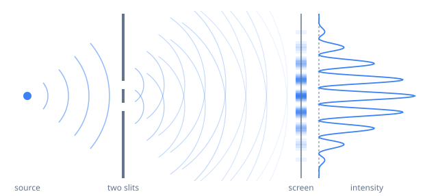

In 1801 Thomas Young passed light through two narrow slits and saw bright and dark bands on a screen behind them. The bright bands are where the waves from the two slits arrive in step and add up; the dark ones are where they arrive out of step and cancel.

## Where the bands are

For slits a distance $d$ apart and a screen a distance $L$ away, with $L$ much larger than $d$, light of wavelength $\lambda$ makes bright bands at

$$
y_m = \frac{m \lambda L}{d}, \qquad m = 0, \pm 1, \pm 2, \dots
$$

so neighbouring bands are $\lambda L / d$ apart. Red light ($\lambda = 650$ nm) through slits 0.25 mm apart, on a screen 2 m away, gives bands 5.2 mm apart.

## One particle at a time

The experiment turns strange when the source is dimmed until only one particle is in the apparatus at a time. Each particle lands as a single dot. After a few dots the screen looks random; after thousands, the bands appear. This has been done with photons, with electrons, and with molecules of about 2,000 atoms.

<!-- kb25:note id=ditp8uqd kind=task at=2026-11-08T10:35:00Z by=admin
> with electrons

Cite the electron version: Tonomura and colleagues filmed the dots building up, American Journal of Physics 57, 117 (1989).
-->
Each particle's wavefunction passes through both slits and interferes with itself, and the bands are the [[id:2m0eeje0u87ok#the-born-rule|Born rule]] at work: the screen shows $|\psi_1 + \psi_2|^2$, not $|\psi_1|^2 + |\psi_2|^2$. The difference between the two is the interference term.

## Watching the slits

Put a detector at the slits to find out which one each particle goes through, and the bands disappear: the screen shows two overlapping smudges, the sum of the two single-slit patterns. It isn't that the detector knocks the particles about. Any record of the path, even one nobody reads, makes the two routes distinguishable, and routes that can be told apart don't interfere.
