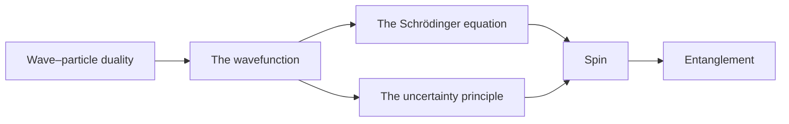

Quantum mechanics describes matter and light at the scale of atoms, where energy comes in fixed amounts, particles behave like waves, and a measurement can only ever give odds. These pages build it up in order: start with [[id:3uaeubqgetixb]] and read down the list.

## Pages

- **Foundations**
  - [[id:3uaeubqgetixb]]: light and matter as both waves and particles
  - [[id:2m0eeje0u87ok]]: the state of a system, and the odds it gives
  - [[id:0rmiavdb9vpd6]]: how a state changes in time
- **[[id:1sn6xgpymimnw|Measurement]]**
  - [[id:2yq61leljl3l6]]: why position and momentum can't both be sharp
  - [[id:1hltrthu6sbtk]]: the simplest quantum system, measured
- [[id:1oye7a74fnmnb]]: correlations no local theory can explain

The experiments behind these ideas are in [[id:24ruefywzek7k|Quantum Experiments]].

## Constants used throughout

| Symbol | Name | Value |
| --- | --- | --- |
| $h$ | Planck constant | $6.626\,070\,15 \times 10^{-34}$ J·s |
| $\hbar = h / 2\pi$ | reduced Planck constant | $1.054\,571\,817 \times 10^{-34}$ J·s |
| $c$ | speed of light | $2.997\,924\,58 \times 10^{8}$ m/s |
| $m_e$ | electron mass | $9.109\,383\,7 \times 10^{-31}$ kg |
| $e$ | elementary charge | $1.602\,176\,634 \times 10^{-19}$ C |
