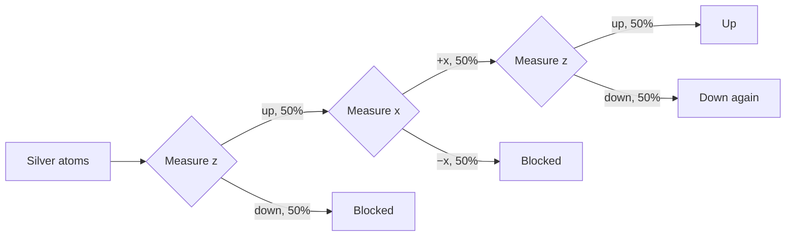

In 1922 Stern and Gerlach sent a beam of silver atoms through a magnetic field that was stronger on one side than the other. Each atom acts as a tiny magnet, and if those magnets pointed every which way, the beam should have smeared into a continuous band. Instead it split into exactly two spots.

The magnet in each atom comes from its outermost electron's *spin*: an angular momentum built into the electron, which has nothing to do with it physically turning. Along whatever axis it is measured, an electron's spin has only two possible values, $+\hbar/2$ ("up") and $-\hbar/2$ ("down").

## Spin as a two-state system

A spin state needs no wavefunction spread over space. It is just two complex numbers:

$$
|\psi\rangle = \alpha\,|{\uparrow}\rangle + \beta\,|{\downarrow}\rangle, \qquad |\alpha|^2 + |\beta|^2 = 1
$$

Measured along $z$, it gives up with probability $|\alpha|^2$ and down with probability $|\beta|^2$. The spin along each axis is the matrix $\hat{S}_i = \tfrac{\hbar}{2}\sigma_i$, built from the Pauli matrices:

$$
\sigma_x = \begin{pmatrix} 0 & 1 \\ 1 & 0 \end{pmatrix}, \quad
\sigma_y = \begin{pmatrix} 0 & -i \\ i & 0 \end{pmatrix}, \quad
\sigma_z = \begin{pmatrix} 1 & 0 \\ 0 & -1 \end{pmatrix}
$$

These don't commute, $[\hat{S}_x, \hat{S}_y] = i\hbar\,\hat{S}_z$, so by [[id:2yq61leljl3l6|the uncertainty principle]] no state has a definite spin along both $x$ and $z$.

## Measurements in sequence

Chaining Stern–Gerlach magnets shows what a measurement does to a state. Keep only the atoms that came out up along $z$, and a second $z$ magnet sends every one of them up again. Put an $x$ magnet in between, though, and the first $z$ result is lost:

<!-- kb25:note id=azcq58mj kind=agent at=2026-11-08T10:30:00Z by=agent
> each stage

I wrote the percentages per stage, so each one is a share of the atoms that reached that magnet, not of the original beam.
-->
The percentages are for each stage. The $x$ measurement leaves every atom in an equal superposition of up and down along $z$, so the last magnet splits them evenly once more. A two-state system like this is the *qubit* of quantum computing, and two of them can be [[id:1oye7a74fnmnb|entangled]].
