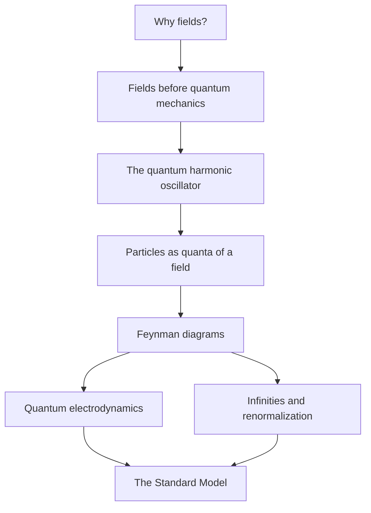

Quantum field theory is how physics describes the smallest things we know of. Its central idea is simple to say and strange to take in: the world is made of fields, which fill all of space, and every particle (each electron, each photon) is a small, indivisible ripple in one of them.

These pages build that idea up from scratch. You need high-school physics and a little calculus; everything else is explained on the way. Start with [[id:04tc4l0zm9l4l]] and read down the list.

## Pages

- **[[id:16o5w62yauwga|Foundations]]**
  - [[id:04tc4l0zm9l4l]]: what goes wrong when relativity meets quantum mechanics
  - [[id:04t4pd3bd5ihk]]: a field as a chain of springs, and its waves
  - [[id:059wa539q8rd7]]: energy that comes in equal steps
  - [[id:1x8nbgaw6a846]]: where particles come from
- **[[id:01tq75i8c7338|Interactions]]**
  - [[id:1m8taa8bjcuyw]]: pictures that are calculations
  - [[id:2mm217t2bow3t]]: the most precisely tested theory in science
  - [[id:0sdfzcgnhed5x]]: why the answers came out infinite, and how that was fixed
- [[id:10o66kt7dy0me]]: every particle we know of, in one table
- [[id:2wg2n9vdl4lj0]]: books and lecture notes for going further

## About this space

This is an example space: crescent adds it the first time it opens, to show what a knowledge base can hold. It's yours like any other space, so change it, add to it, or delete it from its ⋯ menu in the sidebar when you no longer need it.

Along the way it shows what crescent's pages can do:

| Feature | Where to see it |
| --- | --- |
| Formulas, typeset from TeX | Every page, from [[id:04t4pd3bd5ihk#a-relativistic-field]] on |
| Diagrams drawn from text | The reading order above, and [[id:10o66kt7dy0me#the-forces]] |
| Pictures | [[id:059wa539q8rd7]] and [[id:1m8taa8bjcuyw]] |
| An interactive figure | The chain of springs on [[id:04t4pd3bd5ihk#a-chain-of-springs]] |
| Tables, and a file to download | [[id:10o66kt7dy0me]] |
| Links that survive moves | Every link in this space points at a page's id |
| Labels and tags | Under each page's title; click one to find the rest |
| Notes on a passage | [[id:059wa539q8rd7]] and [[id:1x8nbgaw6a846]] |

Ask the chat (✦ at the top right) about any page, or to write a new one: it reads and writes this space as you would.
