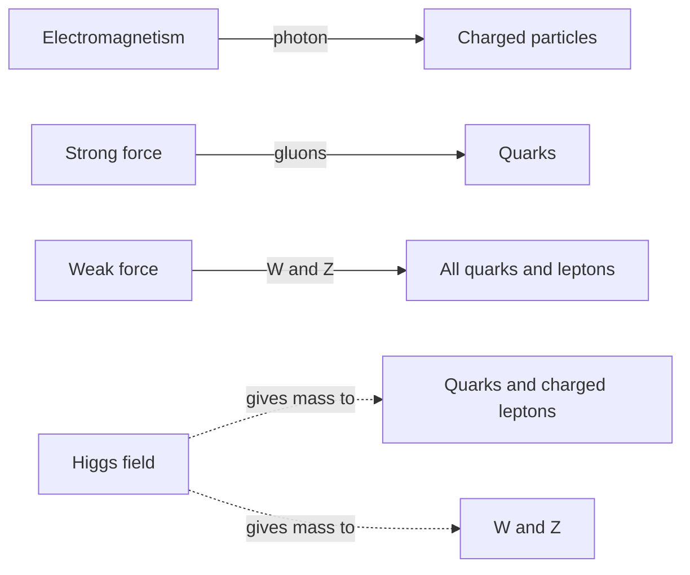

The Standard Model is the quantum field theory of everything we know of except gravity. It has a field for each kind of particle below, and every one of those particles is a quantum of its field, as on [[id:1x8nbgaw6a846]]. Its predictions have held up at particle colliders for fifty years.

## The particles

**Matter** is made of fermions, which come in three generations. Each generation is a heavier copy of the first, and everything around us is made of the first alone: up and down quarks, which make protons and neutrons, and electrons.

| | Generation 1 | Generation 2 | Generation 3 | Charge |
| --- | --- | --- | --- | --- |
| Up-type quarks | up, 2.2 MeV | charm, 1.27 GeV | top, 173 GeV | $+\tfrac{2}{3}$ |
| Down-type quarks | down, 4.7 MeV | strange, 94 MeV | bottom, 4.18 GeV | $-\tfrac{1}{3}$ |
| Charged leptons | electron, 0.511 MeV | muon, 106 MeV | tau, 1.78 GeV | $-1$ |
| Neutrinos | electron neutrino | muon neutrino | tau neutrino | $0$ |

The masses are each particle's rest energy, $mc^2$. The neutrinos' are tiny, under 1 eV, and not yet known.

**Forces** are carried by bosons:

| Particle | Carries | Mass |
| --- | --- | --- |
| Photon | Electromagnetism | 0 |
| Gluons (8 kinds) | The strong force | 0 |
| W⁺, W⁻ | The weak force | 80.4 GeV |
| Z | The weak force | 91.2 GeV |
| Higgs boson | No force; gives the others mass | 125.2 GeV |

[Download these particles as a spreadsheet](_assets/standard-model-particles.csv) to sort or chart them.

## The forces

Each force works the way [[id:1m8taa8bjcuyw]] shows for electrons and photons, with a different field doing the carrying. Electromagnetism is the [[id:2mm217t2bow3t|QED]] of these pages. The strong force binds quarks, and its strength runs the other way from electromagnetism's, as [[id:0sdfzcgnhed5x#forces-that-change-with-energy]] explains. The weak force changes one kind of particle into another, which is how the Sun burns hydrogen into helium.

## The Higgs field

A field normally sits at zero in the vacuum. The Higgs field doesn't: it has a value everywhere, and particles that interact with it gain mass from doing so, more for those that interact more strongly. Its quantum, the Higgs boson, was found at CERN's Large Hadron Collider in 2012.

## What it leaves out

The Standard Model is not the end. It has no place for gravity, it doesn't say what dark matter is, it doesn't explain why neutrinos have mass at all, and its nineteen or so constants are measured, not predicted. Each of these is an open question, and an active field of research.

## Sources

- Particle Data Group, [Review of Particle Physics](https://pdg.lbl.gov/): the particle masses, rounded.
