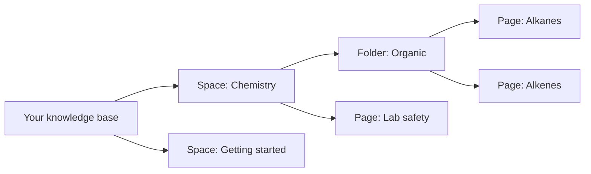

A crescent knowledge base is made of **spaces**, and each space holds **pages**.

## Spaces

A space is a top-level collection, for one subject or one project. The spaces page, the first page crescent opens, lists them all and makes new ones. Each space is a folder on your computer with its own history, so a change in one never touches another.

## Pages and folders

Inside a space, the **sidebar** on the left shows its pages as a tree.

- **New page** adds a page. Every page has a title and a body written in Markdown.
- A **folder** groups pages into a section. It has no text of its own; it holds pages and other folders.
- The **⋯** menu beside a page adds a page under it, labels it, copies its link, archives it or deletes it.
- **Drag** a page to move it: drop it onto another page to put it inside, or onto the line between two pages to put it there.

## Where your pages live

Every page is a plain Markdown file in the space's folder, so your notes never depend on crescent: any text editor can open them.
